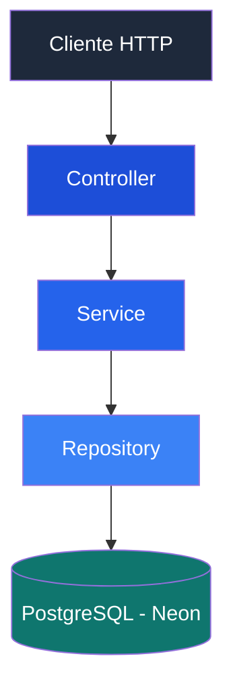

<div align="center">


### Relatório Técnico e Documentação do Projeto

[](https://www.java.com/)
[](https://spring.io/projects/spring-boot)
[](https://maven.apache.org/)
[](https://www.postgresql.org/)

</div>

---

## 📑 Sumário

- [1. Identificação](#1-identificação)
- [2. Problema e Objetivos](#2-problema-e-objetivos)
- [3. Fonte Oficial](#3-fonte-oficial)
- [4. Compreensão dos Dados](#4-compreensão-dos-dados)
- [5. Tratamento e Amostragem](#5-tratamento-e-amostragem)
- [6. Solução e Arquitetura](#6-solução-e-arquitetura)
- [7. Dicionário da Entidade](#7-dicionário-da-entidade)
- [8. API REST](#8-api-rest)
- [9. Decisões Técnicas](#9-decisões-técnicas)
- [10. Dificuldades Encontradas](#10-dificuldades-encontradas)

---

## 1. Identificação

| Informação | Descrição |
|:---|:---|
| **Projeto** | Sistema de Análise de Estabelecimentos de Saúde (SAES CNES) |
| **Disciplina** | Programação Avançada Orientada a Objetos |
| **Grupo** | 01 |
| **Data** | 31/10/2026 |

## 2. Problema e Objetivos

A gestão descentralizada do Sistema Único de Saúde (SUS) exige clareza sobre os estabelecimentos de saúde disponíveis à população.

O **SAES CNES** foi desenvolvido com o objetivo de importar, mapear e analisar a rede de atendimento a partir de dados oficiais do Ministério da Saúde.

### Objetivos principais

- Importar dados de estabelecimentos de saúde.
- Organizar informações provenientes do CNES.
- Permitir consultas e filtragens dos registros.
- Disponibilizar os dados por meio de uma API REST.

## 3. Fonte Oficial

A extração do conjunto oficial de dados foi realizada por meio de ferramentas de linha de comando via **FTP**, acessando diretamente os repositórios públicos do DATASUS.

| Informação | Descrição |
|:---|:---|
| **Servidor** | `ftp.datasus.gov.br` |
| **Origem** | DATASUS |
| **Ambiente** | Linux Xubuntu |
| **Método** | Transferência via FTP |

🔗 [Acessar o DATASUS](https://datasus.saude.gov.br/)

## 4. Compreensão dos Dados

Durante a análise do conjunto de dados, foram identificados e mapeados os seguintes campos:

| Campo original | Finalidade |
|:---|:---|
| `codigo_cnes` | Identificação do estabelecimento |
| `nome_fantasia` | Nome do estabelecimento |
| `uf` | Unidade federativa |
| `municipio` | Município de localização |
| `tipo_estabelecimento` | Classificação do estabelecimento |
| `esfera_administrativa` | Esfera administrativa |
| `atende_sus` | Indicação de atendimento pelo SUS |

A conversão dos valores `SIM/NAO` para valores booleanos garante a tipagem forte exigida no modelo da aplicação.

## 5. Tratamento e Amostragem

Devido à capacidade de hardware restrita do ambiente de desenvolvimento, aproximadamente **3.7 GiB de memória RAM e swap**, o carregamento integral do dataset na memória tornou-se inviável, causando estouros de heap.

Como alternativa, foi estruturada uma amostra programática representativa de **500 registros**.

### Etapas de tratamento

1. Leitura dos registros do arquivo CSV.
2. Remoção de espaços desnecessários.
3. Validação da quantidade mínima de colunas.
4. Rejeição de linhas com menos de 7 colunas delimitadas por `;`.
5. Conversão dos campos booleanos.
6. Seleção da amostra de registros.

## 6. Solução e Arquitetura

O projeto foi desenvolvido no ecossistema **Java**, com gerenciamento de dependências realizado pelo Maven.

A aplicação utiliza Spring Boot para disponibilização dos serviços REST, JPA/Hibernate para persistência e PostgreSQL hospedado na Neon.

### Arquitetura em camadas



### Responsabilidades

| Camada | Responsabilidade |
|:---|:---|
| **Controller** | Expõe métodos GET, POST, PUT e DELETE, mapeando HTTP para ações. |
| **Service** | Encapsula as regras de importação de CSV via `multipart/form-data`. |
| **Repository** | Executa consultas nativas e dinâmicas para filtragem dos registros. |

## 7. Dicionário da Entidade

A entidade principal da aplicação representa um estabelecimento de saúde.

| Atributo | Tipo | Restrição |
|:---|:---|:---|
| `id` | Long | Gerado automaticamente pelo banco |
| `codigoCnes` | String | Obrigatório |
| `nomeEstabelecimento` | String | — |
| `uf` | String | Máximo de 2 caracteres |
| `atendeSus` | Boolean | — |

## 8. API REST

A API disponibiliza seus recursos por meio do endpoint:

```http
/api/estabelecimentos
```

### Respostas HTTP

| Código | Significado |
|:---|:---|
| `200 OK` | Operação realizada com sucesso |
| `201 Created` | Registro criado |
| `400 Bad Request` | Requisição inválida |
| `404 Not Found` | Identificador não encontrado |

## 9. Decisões Técnicas

Uma das decisões adotadas foi a utilização da classe `Optional`, nativa do Java, nos Controllers.

Essa abordagem permite tratar resultados potencialmente inexistentes nas consultas por ID, evitando retornos nulos não tratados e permitindo responder com `NotFound` quando o registro não é localizado.

## 10. Dificuldades Encontradas

### Gerenciamento de memória

A principal limitação enfrentada foi o processamento de arquivos massivos, devido à capacidade de memória disponível no ambiente de desenvolvimento.

**Solução:** adoção de amostragem controlada de registros, limitando o volume de dados processados.

### Gerenciamento de dependências

Também foram enfrentadas dificuldades relacionadas à resolução de dependências no arquivo `pom.xml`.

**Solução:** padronização das dependências e configurações do Maven para manter a consistência do ambiente de build.

---

<div align="center">

**SAES CNES | Relatório Técnico**

Desenvolvido como atividade acadêmica da disciplina de Programação Avançada Orientada a Objetos.


</div>
